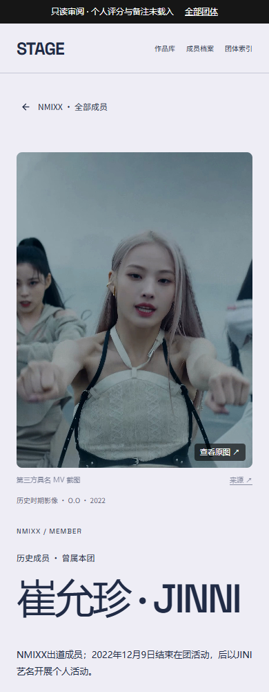
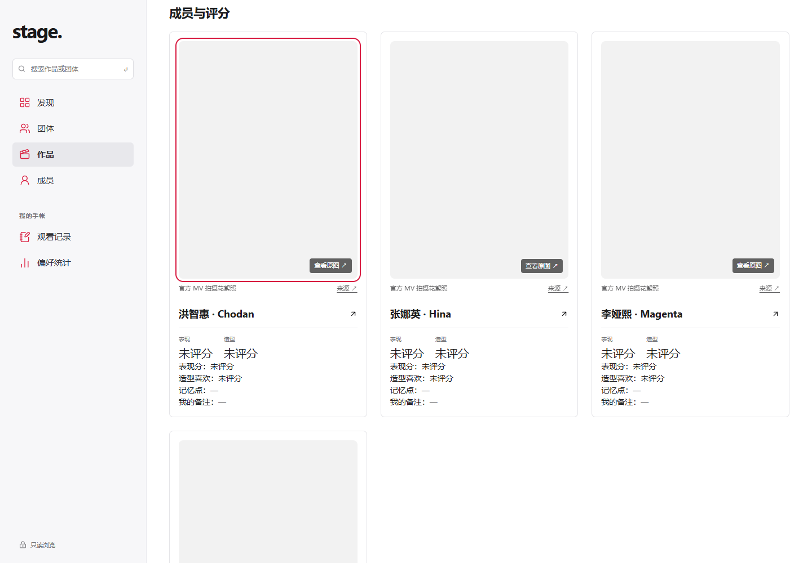

# v9 续作、发布与完整检查报告（2026-10-26）

用户确认v8后，本轮已先将完整v8报告及发布原件上传GitHub，再完成以下续作并发布同一指定站点v9。保留51团已确认视觉、Apple Music风格共享主站和手帐；没有复用旧设计冒称重新设计。站点仍为owner-private只读，个人评分、备注和观看状态未修改。

- [指定正式站点](https://idol-all-groups-review-oct25.wuke40758.chatgpt.site/)
- [当前线上完整报告](https://idol-all-groups-review-oct25.wuke40758.chatgpt.site/review-all/completion-report.html)
- [v9完整51团数据与个人页表HTML](reports/20261026-v9/completion-report.html) · [1579条待补图CSV](reports/20261026-v9/missing-mv-identities.csv)
- [可复核验证记录](data-gap-followup-verification-20261026.json) · [工作日志](worklogs/20261026-data-gap-followup.md)

## 已解决

|项目|本轮变化|当前结果|
|---|---|---|
|认人图|新增IZ*ONE103、QWER4、Geenius5，共112条|累计1249条，覆盖218作品、42团；628精确视频封面保持齐全|
|构图|112条新增图按3:4逐格看图，修正21处|保留112个原文件20,350,347 bytes；展示裁切不改变原字节|
|历史档案|恢复NMIXX/JINNI、LE SSERAFIM/KIM GARAM详情和历史入口|338个团体成员上下文均有有效独立详情；当前名册保持|
|手帐导航|BADVILLAIN七详情新增精确共享入口；三团个人作品接入公开图|个人详情→共享手帐→原详情往返通过|
|统计证据|XG一位未知0改为来源明确0|27团正数、21团确认0、3团未知0；计数没有独立截至日，asOf=null|

112条全部绑定已有work/member/video关系，无新评分关系。QWER用官方《Discord》MV拍摄现场具名照；Geenius按五个官方成员版精确ID及oEmbed姓名标题绑定；IZ*ONE使用精确MV具名图库和唯一原版具名MV章节。后一类不是本轮独立逐帧核验。来源与原图限制见[图片增量证据](mv-identity-followup-20261026.md)。

## 未解决

- 1579条既有关系仍缺合格公开图；387作品尚无公开认人图，其中133作品原无成员关系。缺图不得关闭成员评分，只有已核实的5个无成员真人出镜精确视频关闭成员评分。
- 47条图片仍为小卡片清晰度。AtHeart《Plot Twist》六格有大号文字覆盖，不纳入；Hearts2Hearts《The Chase》八格仍待高清替换。IZ*ONE仍3条、QWER17条、Geenius5条待补。
- 18项统计仍未知：社媒6项（GENBLUE X、VVUP X、GIRLSET X、EVERGLOW X/INS、Cherry Bullet X），累计销量9团（BADVILLAIN、VVUP、BEWAVE、Geenius、TRACER、W!TCHX、SPIA、UDTT、VCHA），一位3团（GENBLUE、TRACER、VCHA）。按用户要求显示0，证据仍区分未知与确认零。[逐项查询与排除原因](statistics-followup-20261026.md)。
- 个人页仍7类编排；4团33详情默认折叠资料、7团56详情缺叙述简介/经历。共享页279个有经历、323个有作品关系。尚未统一排版，等待用户根据盘点决定；不是以本轮功能修复代替统一设计。
- 12条已有图候选因没有对应成员/作品关系继续隔离；14个历史hold事件与其余先前资料缺口按原证据继续保留。

## 验证

Browser plugin not available，因此使用现有Playwright与系统Chrome。线上使用站点服务身份，不代替用户IAB会话。目标流程：成员目录→历史详情/当前详情→原图或共享手帐→精确返回；作品详情→112条新增认人图→原图弹窗→关闭。

|检查|结果|证据|
|---|---|---|
|专项/回归测试|40通过、0失败|归档focused-tests.txt|
|类型/正式构建|通过|归档typecheck.txt、production-build.txt|
|个人页|本地及线上各45布局、11流程|9详情×320/390/768/1440/2560；JSON记录|
|新增图片|本地及线上各30布局、3原图流程|15作品×390/1440；112图加载、3:4、无横向溢出|
|页面身份、非空与运行异常|目标路由/标题/主内容及控件存在，0 pageerror；四路由无console warning/error及框架错误遮罩|线上三份QA JSON；截图|
|原始媒体|新增112原文件HTTP、字节数、SHA全通过|github-originals-http.json|
|报告|两张51行表和当前累计/缺口数字通过|online-media-qa.json|

不是全仓测试通过：旧historical-affiliation.test.cjs仍有IZ*ONE旧`.candidate-izone .ca-ordinal`选择器断言失败，相关源码/测试与冻结基线未改。本轮没有通过放宽该断言掩盖问题。真实生产保存、所有视频完整播放、80%/125%原生缩放、用户本人IAB和新Figma同步未验。

## 发布

发布来源、版本、部署ID与包大小见验证JSON。仅更新用户指定站点，不改旧v186，不合并main。新增公开原图已固定到GitHub提交`bee7df466f7d1e5cce6f671420675e48e7dc751e`；来源站点图片部分同站交付、部分由固定公开提交提供，未压缩原图。静态文件总量259,163,908 bytes、1166个同站原文件，发布源清理44个已不再引用的旧生成素材时逐个核对范围与旧SHA。

## 截图

