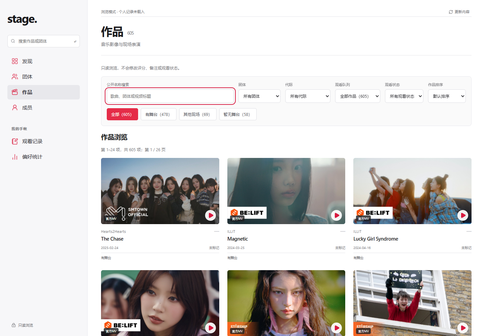
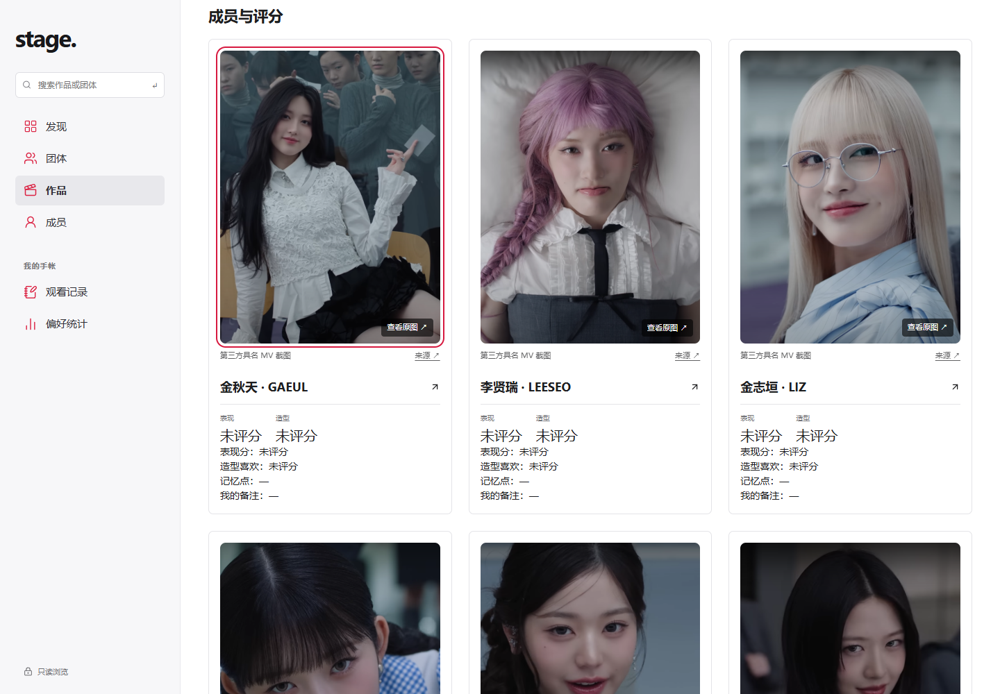

# MV封面修复与认人图批量补齐报告（v11）

[指定正式站点](https://idol-all-groups-review-oct25.wuke40758.chatgpt.site/?view=works) · [线上完整报告](https://idol-all-groups-review-oct25.wuke40758.chatgpt.site/review-all/completion-report.html) · [完整51团HTML归档](reports/20261026-v11/completion-report.html) · [922条待补CSV](reports/20261026-v11/missing-mv-identities.csv) · [验证JSON](mv-cover-identity-batch-verification-20261026.json)

用户确认v9后，本轮修复共享作品列表的封面遮挡，并完成657条真实图片增量。保留51团已认可风格和共享手帐布局；本轮不是重新设计。站点仍owner-private只读，个人记录、成员关系、稳定ID不改，旧v186和main未改。

## 已解决

- **封面遮挡**：官方MV小标签继承旧样式的四边定位，被拉成覆盖大部分封面的黑块。完整重置定位并限制标签宽度后，图片清晰显示，播放按钮和作品入口保持。先独立发布v10，使此修复不等待补图。
- **批量补图**：新增657条、涉及22团114个既有作品。缺图关系从1579降至922，减少41.6%；累计1906条，覆盖312作品/42团。657原文件382,619,101 bytes，未压缩或改绘。
- **可重复的补图方法**：将缺口按准确作品/视频/成员分组，集中读取具名MV章节和官方拍摄专题；逐张3:4看图后用导入脚本检查关系、来源、SHA、实际尺寸、裁切和重复项。默认dry-run，全部合格才apply，不自动批准候选、不新增评分关系。[方法及使用命令](mv-identity-batch-method-20261026.md)。
- **来源分类**：tripleS《Baby Flower》24图为官方具名MV拍摄现场；633条为第三方具名MV章节（含1条明确Side A的版本章节）。来源没嵌YouTube ID时标记false，按唯一作品/明确版本依据绑定，不冒称本轮独立逐帧验证。
- **质量门槛**：27张最终联系表逐一审阅，657采用图完成133处构图修正。没有为降低缺口数字新增card_only，既有47条清晰度待提升仍保留提示。原镜头已有柔焦、暗光、极近景限制不能通过裁切恢复，不统一承诺每张脸部细节高清。

|团体|本轮新增|当前仍缺关系图|
|---|---:|---:|
|BABYMONSTER|45|35|
|Billlie|24|10|
|Cherry Bullet|28|0|
|EVERGLOW|12|4|
|ITZY|5|32|
|IVE|53|49|
|KISS OF LIFE|10|29|
|Kep1er|67|33|
|LE SSERAFIM|3|39|
|LOONA|21|2|
|NMIXX|16|44|
|NewJeans|20|31|
|PURPLE KISS|14|6|
|Rocket Punch|24|0|
|STAYC|18|27|
|WOOAH|30|6|
|Weeekly|14|6|
|XG|74|34|
|aespa|12|25|
|fromis_9|53|23|
|i-dle|54|49|
|tripleS|60|47|

逐图来源、原文件、版本依据和未选候选见[批次A](mv-batch-a-20261026.md)、[批次B](mv-batch-b-20261026.md)、[批次C](mv-batch-c-20261026.md)。这三份研究报告保留交接时点；当前整合/发布状态以本报告为准。

## 仍未解决

- 922条既有关系缺图；293作品尚无公开认人图，其中133作品原本没有成员关系，不能猜全员参演。仅原来已核实的5个无成员真人出镜精确视频关闭成员评分。
- 47条已有图仍待提高清晰度。Hearts2Hearts五MV40格、ILLIT两MV10格的具名拼图因有效像素/文字覆盖或柔糊留pending；Tick-Tack另5张单人截图仍有正式MV/Performance版本歧义。AtHeart既有文字覆盖候选仍未采用。
- 部分来源没有新歌章节、原图尺寸不足、人物遮挡/过小或存在版本冲突，已保留具体原因，未用概念照填认人图。访问受限来源没有绕过。
- 18项统计仍未知：6项社媒、9团销量、3团一位。按用户要求显示0，来源中仍区分未知与确认零；本轮不把上轮未找到的数据描述成新查得。
- 个人页仍7类编排，4团33详情默认折叠资料、7团56详情无叙述简介/经历；统一排版待用户下一步决定。v9恢复的两历史详情和七手帐入口保持。

## 验证与发布边界

|检查|本轮结果|
|---|---|
|专项测试|13通过、0失败；含错视频/错成员拒绝、重复/路径/低清拒绝、原图完整性与现有评分规则|
|类型与正式构建|通过|
|封面六宽|本地与线上各144卡片，320/390/768/1440/2560/3840；详情进入和返回通过，控制台warning/error及pageerror均0|
|本地全部新增作品|114作品×390/1440，共228布局；657新图全部解码加载，3:4且无横向溢出；22团原图流程|
|线上服务身份|每团至多两个新增涉及作品，84布局、22原图打开/解码/关闭流程，0 pageerror|
|原文件|657个GitHub固定提交原文件HTTP/长度/SHA全通过；9个初次TLS连接错误以正常证书验证重试后通过|

Browser plugin not available，使用既有Playwright与系统Chrome。线上是服务身份检查，不是用户本人IAB。真实保存、全部视频完整播放、80%/125%原生缩放、新Figma同步及全仓测试没有完成。本轮没有写入真实个人记录。站点源与版本/部署ID、容量和逐项归档SHA见验证JSON。

原图固定GitHub提交`a250a4d683871624d36b0283499532daea63e9de`。大原图部分使用固定公开提交，1314份同站原图；静态包容量259,580,239 bytes，未压缩原图。构建清理118个不再引用的旧生成资源前逐个核对旧SHA及目录范围，不删除源码原图。v8/v9归档原件保持。

## 线上截图

## GitHub交接

GitHub实现与完整报告已推送：`74007464dc10ef1d9b5c41d28c653fcf98044d43`；[draft PR #40](https://github.com/KAtOReNA7/idol/pull/40)，目标分支`codex/data-gap-followup`，未合并main。
