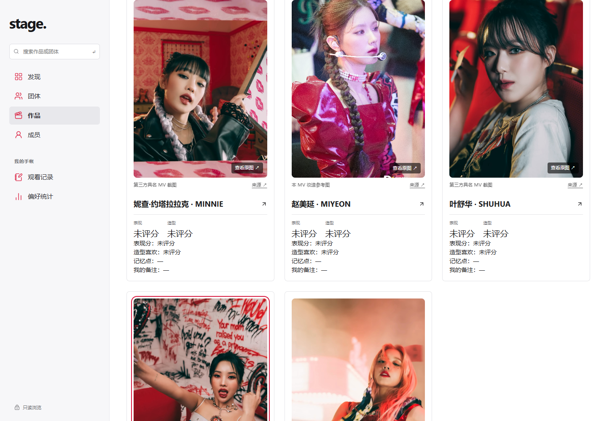

# 认人图与旧图质量续作：v12候选已验，发布受阻

本批19条官方具名MV现场图和4张旧图提质已接入并推送 [draft PR #41](https://github.com/KAtOReNA7/idol/pull/41)。**线上仍是用户已确认的v11；本候选未发布，不称v12已上线。** 两份不同体积包均在文件上传层300秒超时，原生推送后私密发布也未获服务接受。

[验证JSON](mv-identity-quality-followup-verification-20261026.json) · [51团候选完整表](reports/20261026-v12/completion-report.html) · [903条待补CSV](reports/20261026-v12/missing-mv-identities.csv) · [本轮日志](worklogs/20261026-mv-identity-quality-followup.md) · [恢复入口](NEXT-COMPUTER-HANDOFF.md)

|项目|已上线v11|本批候选|
|---|---:|---:|
|认人图绑定|1906|1925|
|有图作品 / 团体|312 / 42|316 / 44|
|既有关系缺图|922|903|
|旧低清主图|47|43|
|精确视频封面|628|628|
|未知统计项|18|18|

## 已解决

- [D批](mv-batch-d-20261026.md)：ifeye《r u ok?》3、ODD YOUTH《I Like You》4；[E批](mv-batch-e-20261026.md)：GENBLUE《ACT LIKE THAT》《BADASS》各6。19份原文件10,475,508 bytes均未压缩改绘，展示统一3:4。
- 来源为官方具名MV拍摄现场；未嵌YouTube ID的来源按当前唯一现有MV版本消歧，保留sourceEmbedsExactVideo=false，不称独立逐帧验证或MV截图。
- [4张提质](mv-quality-promotions-20261026.md)：Jisun《WE GO》、小娟/Minnie/雨琦《TOMBOY》切换为具名精确MV截图。旧记录完整移入备选，所有旧原图保留。10备选中6张因柔糊、暗光或切脸排除，未按像素机械提升。
- 新增默认dry-run的旧图提升工具：冻结审计、严格三元组、旧新SHA/字节/实际尺寸、既有评分ID、具名精确视频来源、人工3:4复核和裁切边界全部通过才apply，不新增成员关系。
- 提质先从审计SHA f43a12f2ba88348d25856ff9300bb5ddaa4324f5f27c2e72334a5a689b7b9c68执行，非图片领域及workCoverage深比不变后，再冻结cb76e88aa43eb12682b599e321b7750d70967793e946b57ccc5583ab19377a06一次导入D/E。没有重跑A/B/C或关闭缺图成员评分。[整合证据](reports/20261026-v12/promotion-integration.json)。

## 验证

|层级|结果|
|---|---|
|专项与工程|6导入边界、9提质边界、8公开图片/精确成员评分规则，共23通过；运行投影check、类型检查和正式构建通过。构建保留既有大chunk/插件耗时提示。|
|最终本地浏览器|Windows，同机HTTP200；Browser plugin not available，使用既有Playwright与已核实系统Chrome155。320/390/1440，6作品×3宽=18布局、69次精确图解码/3:4检查、29原图打开/Tab/Shift+Tab/Escape/焦点返回与作品库返回流程全部通过。|
|页面健康|标题与地址正确、非空白、无框架错误层；console error/warning、pageerror、非读取请求均0。|
|原字节|23份受影响远端原图HTTP/类型/长度/SHA/解码通过；缩小上传包后，588份改从固定GitHub加载的原图同样全部通过。735份最终同站原文件长度/SHA通过。|
|设计及数据保护|52份路由CSS仅资源固定引用与行尾规范化后相同。两次实际bundle AST提取深比证明公开payload仅52个loadedAt构建时间戳不同，其他值、ID与关系相同；原快照、统计源、app与lib源码无diff。|
|发布|未完成，详见下节。新候选线上浏览器未执行，不能继承v11旧验收。|

流程为精确作品→具名图→解码原图→键盘关闭与焦点回归→返回作品库。完整细项见[本地JSON](reports/20261026-v12/local-browser.json)、[23原图](reports/20261026-v12/remote-originals.json)、[588转外域图](reports/20261026-v12/moved-originals.json)及[发布预检](reports/20261026-v12/publication-preflight.json)。

## 发布阻断与可恢复成果

同一项目 appgprj_6add2704bc6c81918d3e0e2f13130422、owner-private静态只读未变。首份259,681,549-byte静态输出打包242,168,264 bytes，在archive blob上传层300,003ms超时，未返回版本/部署ID。采用可选138MiB原图同站预算后，保留695份必要封面/索引/修复图143,354,239 bytes在站内；其余原图使用既有不可变GitHub传输，原字节不改。最终静态163,153,529 bytes、724同站公开原图，上传包148,157,406 bytes，仍在同一上传层300,005ms超时。

两次失败后get_site/list_site_versions均确认最新保存仍v11，已发布源c28c945987e22803b81ea266e6aaadf1ce972cb0。上传超时根因未知；不能归因于包体、权限或站点部署。Sites原生publish_on_push=private返回accepted=false，未用它宣称发布。已停止重复失败路径。

Sites候选源码已由原生helper提交推送为e709d347e61bb867e41c441a961e9266c08bd824，可在恢复的上传环境直接续发；全部公开原图固定提交e3f9933f999a1c18c5efb40f76e1732b10a4d94b。GitHub main和旧v186未改；私有UDTT原图仍仅在原Sites范围，不把发布包放入公开GitHub。

## 未解决和未验证

903条关系仍缺合格图、43旧图待提质、18统计未知；289作品暂无公开认人图，其中133作品原无成员关系，不猜全员参与。H2H低像素拼图、ILLIT柔糊/版本歧义、AtHeart文字覆盖候选未批准。ifeye另3人及ODD YOUTH Summer因远脸或低有效宽排除；无具名或仅概念/拍摄语义不明的来源不采用。

本批部分统计来源实际复查未得合格新数字，不宣称18项全部重新覆盖；null与确认零仍区分。个人页统一排版待用户决定。51团已认可设计、Apple Music主站、稳定ID、全部关系和个人记录、5条无真人规则及原访问/保存边界保持。

新候选线上、真实保存、全部视频完整播放、80%/125%原生缩放、用户IAB、新Figma和全仓测试未验。

## 画面证据

采用图最终3:4：[D批](reports/20261026-v12/batch-d-3by4.jpg)、[E批](reports/20261026-v12/batch-e-3by4.jpg)；旧图对照与未采用原因见提质报告。Browser插件可供后续应用内验收，本批使用上述系统Chrome验证。
